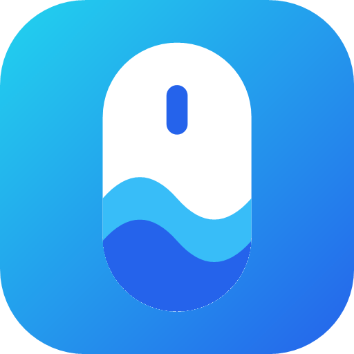
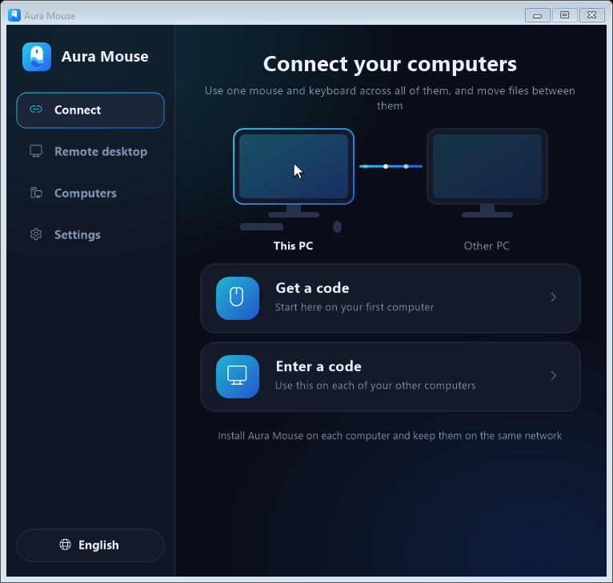
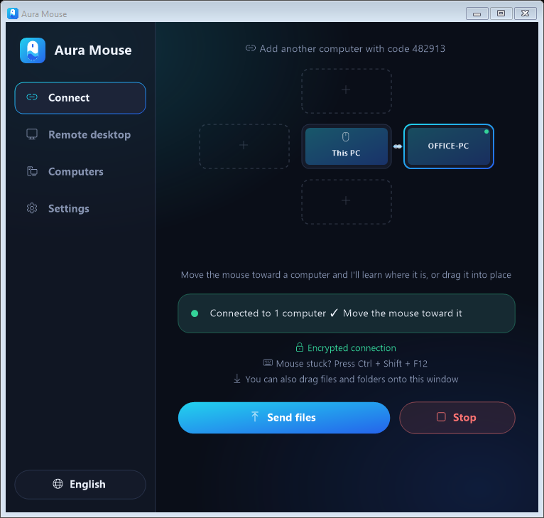

<p align="center">
  
</p>

<h1 align="center">Aura Mouse</h1>

<p align="center">One mouse and keyboard for all your Windows computers, plus remote desktop and phone control. No server and no account.</p>

<p align="center">
  
  
</p>

## What it does

- **Share a mouse and keyboard.** Move the cursor off the edge of one screen and it appears on the next computer.
- **Share the clipboard and files.** Copy on one computer and paste on another, or drag files across.
- **Remote desktop.** See and control another computer on your network, only after its owner approves.
- **Use your phone.** The Android app works as a touchpad and keyboard, sends files and views remote desktops.
- **Turn computers on.** Wake a saved computer from another one or from the phone, if it supports Wake on LAN.
- **Play games safely.** A shortcut locks the mouse to one screen, and another brings it back if it gets stuck.
- **Choose a look.** The Windows app has dark, light and two Liquid Glass themes.

Everything stays on your local network and is encrypted. Devices must be on the same network.

The app is available in English, Arabic, Spanish, French, German, Portuguese, Russian, Turkish, Persian, Hindi,
Indonesian, Chinese, Japanese and Korean.

## Get started

You need Windows 10 or 11 on each computer, and Android 10 or newer for the phone app.

**Using a cut-down copy of Windows?** Download `AuraMouse-Lite.exe` instead. It works the same but is smaller, and the app
copes without the firewall service, Explorer or icon fonts. It may take a little longer to start.

1. Download `AuraMouse.exe` from [Releases](../../releases) and run it on each computer. There's nothing to install.
2. On the first computer, choose **Get a code**. When Windows asks about the firewall, press **Yes**.
3. On each other computer, choose **Enter a code** and type the code.
4. Move the mouse toward the other screen.

For the phone, install `AuraMouse.apk` from Releases, then type a code from **Get a code** on your computer.

Windows SmartScreen may warn you because the program isn't signed with a commercial certificate. Compare the file's
SHA-256 with the one listed in the release before running it.

### Remote desktop

On the computer you want to reach, open **Remote desktop** and turn on **Accepting requests**. It's off until you do.
Then choose that computer from the same page on another computer or on the phone, and approve the request on its
screen. Both screens show the same number, so you can check you're approving the right device.

### Default shortcuts

| Action | Keys |
| --- | --- |
| Lock the mouse to this screen | `Ctrl` + `Alt` + `L` |
| Bring a stuck mouse back | `Ctrl` + `Shift` + `F12` |

You can change both under **Settings**.

## Security

Anyone considering this on a shared network should read [SECURITY.md](SECURITY.md). It covers how pairing and encryption
work, what isn't protected, and how to report a vulnerability. The design hasn't been independently audited.

## Build it yourself

**Windows**, with the .NET 10 SDK:

```bash
cd AuraMouse
dotnet publish -c Release -r win-x64 --self-contained true -p:PublishSingleFile=true -p:IncludeNativeLibrariesForSelfExtract=true -o publish
```

**Android**, with JDK 17, Gradle 8.7 and the Android SDK:

```bash
cd AuraMouseAndroid
gradle assembleDebug
```

For a signed release build, set `AURAMOUSE_SIGNING` to a properties file containing `storeFile`, `storePassword`,
`keyAlias` and `keyPassword`, then run `gradle assembleRelease`. Keep that file and the key out of the repository.

## Translations

Each file in [i18n](i18n) has one line per line of `en.txt`, in the same order. To add a language:

1. Add `i18n/xx.txt`.
2. Add the language to the list at the top of `AuraMouse/Strings.cs`.
3. Run `python tools/gen_android_strings.py`, which checks the files and builds the phone's text.

The translations haven't been reviewed by native speakers, so corrections are welcome.

## License

[MIT](LICENSE)
